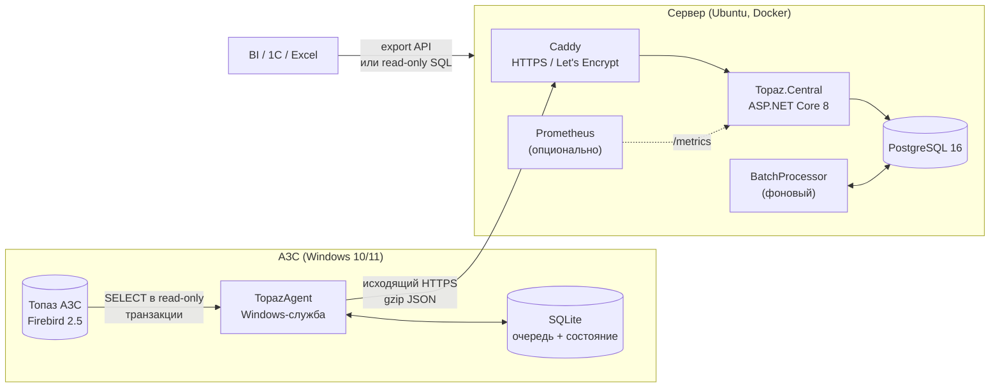
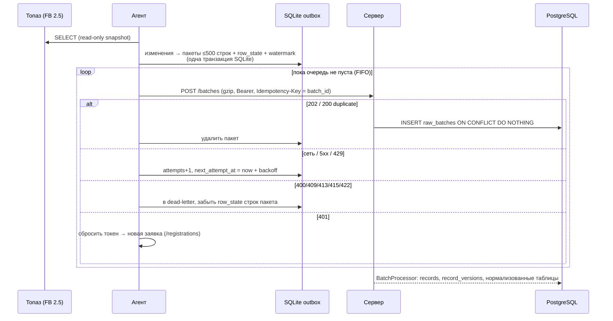

# Архитектура Topaz Center

Система собирает данные с АЗС, где установлена АСУ «Топаз АЗС» (Firebird 2.5), в центральную базу.
У каждой АЗС свой агент. Агент только читает базу Топаза и сам отправляет данные на сервер по HTTPS.

## 0. Допущения и принятые решения

| Вопрос | Решение | Почему |
|---|---|---|
| Стек | .NET 8 для агента и для сервера | Выбор заказчика. **Ограничение:** .NET 8 не работает на Windows 7, агент поддерживает Windows 10/11 и Server 2016+. АЗС на Windows 7 нужно обновить. |
| Центральная БД | PostgreSQL 16 | `jsonb` хранит сырые пакеты и строки любых таблиц Топаза, обычные таблицы и представления дают нормализованный вид. Для 1–20 АЗС этого с запасом хватает. Плюс бесплатная, работает в Docker, для неё есть бэкапы (`pg_dump`) и инструменты BI. |
| Идентификация АЗС | Заявка на подключение + ручное одобрение суперадминистратором с кодом подтверждения → персональный токен (с 1.3; раньше был общий ключ установки) | При установке вводится только название, никаких общих ключей. Чтобы чужой компьютер не выдал себя за АЗС, администратор одобряет заявку, сверив 8-значный код, который видит установщик на АЗС. См. раздел 2.6. |
| Структура БД Топаза | Изучена по реальной базе (Топаз 3.15.20, Firebird 2.5.9, 117 таблиц), см. [topaz-schema.md](topaz-schema.md) | Ничего не придумано: ключи, связи и состав таблиц взяты из метаданных. |
| Часовой пояс | Топаз хранит местное время без смещения. Агент добавляет смещение пояса АЗС (`Station:TimeZone`, по умолчанию пояс Windows), сервер хранит `timestamptz` | Иначе при 20 АЗС в разных поясах время нельзя сравнивать. |
| Что выгружать | 105 из 117 таблиц, список в `datasets.json` | Не выгружаются служебные таблицы репликации и таблицы без PK. Пароли (`dcAgents.Password`, `sysUsers.PswHash/Psw`) и конфигурация платёжных терминалов (`dcPaymentModes.Config`) исключены. |

## 1. Компоненты



**Агент (`src/Topaz.Agent`)** — Windows-служба `TopazAgent`, один exe-файл (self-contained, .NET на АЗС ставить не нужно). Внутри три фоновых процесса:
- `CollectorWorker` раз в минуту открывает одну read-only snapshot-транзакцию к Firebird, читает наборы данных, сравнивает строки с хэшами уже отправленного и кладёт изменения в локальную очередь;
- `SenderWorker` отправляет очередь строго по порядку, повторяет с backoff и сам регистрирует АЗС;
- `HeartbeatWorker` раз в минуту сообщает своё состояние: очередь, ошибки, доступность БД Топаза, текущую смену.

**Центральный сервис (`src/Topaz.Central`)** — ASP.NET Core 8 minimal API:
- `POST /api/v1/batches` сохраняет пакет как есть в `raw_batches` и сразу отвечает 202;
- `BatchProcessor` разбирает пакеты в `records` (текущее состояние строк), `record_versions` (история) и нормализованные таблицы;
- `StationMonitor` обновляет метрики и предупреждает о молчащих АЗС, раз в час чистит старые сырые payload;
- админ-API и выгрузка (NDJSON/CSV).

**Инфраструктура** (`deploy/central/docker-compose.yml`): Caddy (единственный контейнер с открытыми портами), central (read-only файловая система, non-root), PostgreSQL во внутренней сети без выхода наружу, ежедневный `pg_dump`, Prometheus с алертами (profile `monitoring`).

## 2. Схема взаимодействия

### 2.1. Как агент узнаёт, что изменилось

В транзакционных таблицах Топаза (`flOrders`, `sysSessions`, `rgFuels`, …) **нет даты изменения**, а строки меняются уже после вставки: заказ создаётся с объёмом 0 и обновляется по окончании налива. Поэтому выгрузка по watermark «всё, что изменилось после T» здесь не работает. Вместо неё агент сравнивает **хэши строк**:

1. Каждая прочитанная строка сериализуется в канонический JSON: порядок колонок как в результате запроса, фиксированные форматы дат и чисел. От этого JSON считается SHA-256.
2. Локальная таблица `row_state(dataset, key) → hash` хранит хэш последней поставленной в очередь версии.
3. Строка отправляется (`upsert`), только если её нет в `row_state` или хэш другой. Строка, которая была в `row_state`, но исчезла из области чтения, отправляется как `delete`.

Область чтения зависит от вида набора (`kind` в `datasets.json`):

| Вид | Таблицы | Что читается за цикл | Удаления |
|---|---|---|---|
| `session` (28) | всё со `SessionID`: заказы, резервуары и ТРК за смену, приход топлива, чеки, касса, регистры; дочерние таблицы (`trFastTradeD`, `flOrdersExtInfo`) — через JOIN к родителю | **окно смен**: открытые + последние N закрытых (`ClosedSessionsWindow=3`) + очередная порция старых (`BackfillSessionsPerCycle=20`) | да, в пределах окна |
| `incremental` (3) | журналы: `sysEvents`, `flTankLevelEvents`, `flLogRegisterValues` | `id > watermark − overlap`, не больше `IncrementalRowsPerCycle` | нет (только добавление) |
| `snapshot` (74) | справочники, документы без смены, регистры остатков | вся таблица раз в 15 мин (крупные регистры — раз в час) | да |

- **Watermark** есть у `incremental` (`wm:<dataset>`) и у прохода по сменам (`session_cursor`). Раз в сутки (`FullRescanHours=24`) курсор сбрасывается, и агент заново проходит все смены. По сети при этом уходят только реальные изменения, то есть поздние правки закрытых смен тоже доезжают.
- **Overlap** (по умолчанию 1000 ID) нужен потому, что генераторы Firebird выдают ID при вставке, а не при коммите: транзакция с меньшим ID может закоммититься позже. Агент перечитывает хвост и по `row_state` отправляет только пропущенные строки.
- **Согласованность.** Все наборы одного цикла читаются в одной snapshot-транзакции, поэтому заголовки чеков совпадают со своими строками.
- **Память не зависит от размера базы (1.10.1).** Строки читаются потоком и обрабатываются порциями по `Collection:ChunkRows` (1000): для порции из `row_state` берутся хэши только её ключей, изменения и `row_state` порции фиксируются одной транзакцией SQLite. Увиденные ключи пишутся в `scan_seen`; удаления считаются только после того, как набор дочитан до конца (прерванное чтение удалений не порождает). Сначала читаются наборы смен, сразу после них сдвигается курсор догрузки; остальные наборы читаются каждый сам по себе — ошибка одного попадает в статус агента («набор: ошибка»), остальные продолжают поступать.
- **Нагрузка на Топаз.** Одно короткое соединение в минуту без пула, read-only транзакция (не задерживает сборку мусора Firebird), выборки по индексированным `SessionID`/PK.

### 2.2. Очередь, батчи, подтверждения



- **Атомарность на агенте.** Пакет ставится в outbox в той же транзакции SQLite, что и обновление `row_state` и watermark. Если агент упадёт посреди цикла, ничего не потеряется: в худшем случае строки будут отправлены повторно, а сервер это переварит.
- **Порядок.** Пакеты отправляются по одному, строго по `seq`. Пока головной пакет не подтверждён, следующие ждут. Каждая строка в пакете — это её полное состояние, поэтому соблюдать порядок достаточно, чтобы на сервере осталась последняя версия.
- **Backoff.** `random(0, min(900 с, 5 с × 2^attempt))` (full jitter, минимум 1 с). Если сервер прислал `Retry-After`, агент ждёт столько, сколько указано. Сетевые ошибки, 404, 429 и 5xx повторяются бесконечно: данные не выбрасываются.
- **Идемпотентность на трёх уровнях:**
  1. `batch_id` (UUID, создаётся при постановке в очередь и не меняется при повторах). На сервере `UNIQUE(station_id, batch_id)`. Повтор возвращает `200 duplicate`, а тот же id с другим содержимым — `409` (это сравнивается по SHA-256 тела).
  2. Строка: `records` обновляется, только если поменялся `hash`. Поэтому повторная отправка после потери локального состояния не создаёт новых версий.
  3. Нормализованные таблицы обновляются через `INSERT … ON CONFLICT (station_id, pk) DO UPDATE`.
- **Офлайн.** Очередь в SQLite (WAL, `synchronous=FULL`) переживает перезагрузки и недели без связи. Если очередь больше `MaxQueueBytes` (2 ГБ), сбор приостанавливается. Данные при этом не теряются: они остаются в Топазе и будут прочитаны позже.
- **Dead-letter.** Если сервер окончательно отклонил пакет, агент откладывает его, а хэши его строк забывает, поэтому следующий цикл перечитает и переотправит эти строки. Посмотреть такие пакеты можно командой `TopazAgent.exe status`, вернуть в очередь — `TopazAgent.exe requeue-dead`. Счётчик `queue_dead` приходит на сервер в heartbeat.

### 2.3. Обработка на сервере

- Приём не зависит от обработки: если нормализация упала, пакет уже сохранён в `raw_batches`, и агенту отвечать ошибкой не нужно.
- `BatchProcessor` берёт самый старый пакет такой АЗС, у которой нет более раннего необработанного пакета (`FOR UPDATE SKIP LOCKED`). Так соблюдается порядок внутри АЗС, а разные АЗС не мешают друг другу.
- Пакет, на котором обработка упала 5 раз, получает статус `failed` и блокирует только свою АЗС. Это видно в алерте `TopazProcessingFailed` и в `GET /admin/batches`. После исправления причины администратор вызывает `POST /admin/batches/{id}/reprocess`.
- Неизвестный набор данных (агент новее сервера) тоже сохраняется в `records`, так что обновлять сервер одновременно с агентами не обязательно.

### 2.4. Автообновление агентов

- **Сборка.** CI собирает zip агента (`win-x64`, `win-x86`) и `manifest.json` (версия, платформа, sha256, размер). Манифест подписывается ECDSA P-256 ключом из секрета GitHub `AGENT_SIGNING_KEY`. Пакеты кладутся в образ сервера (`/app/agent-updates/<версия>/<rid>/`) и в релиз GitHub.
- **Модель доверия.** Открытый ключ встроен в агент (`Updating/UpdateKeys.cs`), закрытого нет ни на сервере, ни на АЗС. Агент ставит пакет, только если подпись верна, платформа его, версия новее текущей, а sha256 и размер zip совпадают с манифестом. Сервер лишь раздаёт файлы, поэтому даже его взлом не позволяет установить на АЗС чужой код. CI отказывается подписывать, если ключ не соответствует встроенному.
- **Предложение.** В ответе на heartbeat сервер передаёт `update: {version, rid}` — по правилам раскатки (`Updates/UpdatePolicy.cs`): пилотные АЗС сразу, остальные после задержки и успеха пилотных; пауза, выключение, «не обновлять», «обновить сейчас».
- **Установка.**
  1. Агент скачивает пакет (`GET /api/v1/agent/updates/{version}/{rid}/{file}` с токеном АЗС) и распаковывает его в `%ProgramData%\TopazAgent\updates\<версия>`.
  2. Новый exe запускается командой `apply-update` из одноразовой задачи планировщика от SYSTEM.
  3. Установщик останавливает службу, делает резервную копию, заменяет файлы (кроме `appsettings.json`) и запускает службу.
  4. Затем ждёт метку `started.json`: новая версия пишет её после первого успешного heartbeat.
  5. Если метки нет 3 минуты или служба падает, установщик возвращает резервную копию.
- **Отчёт.** Результат пишется в `result.json`, агент передаёт его в heartbeat (`update: {version, status, error}`). Сервер хранит отчёты в `agent_update_reports` и создаёт событие при ошибке. Повторные попытки после ошибки — не чаще раза в сутки, не больше 3 на версию.
- **Совместимость.** Протокол меняется только добавлением полей. Агенты до 1.2 не передают `rid` и не получают предложений.

### 2.5. Здоровье ПК АЗС

- В heartbeat агент 1.2.1+ передаёт `host`: место на диске с базой и на системном диске, размер файла базы (метаданные, файл не открывается), время ПК (UTC и местное) и пояс Windows, время работы, версию ОС.
- Сервер:
  - считает расхождение часов как «местное время ПК − точное время в поясе АЗС». Так видны и сбитые часы, и неверный пояс Windows;
  - хранит по одной строке в день (`station_host_daily`) — для роста базы и прогноза, когда кончится место;
  - создаёт события `disk_low` и `clock_skew`, которые закрываются сами, когда проблема устранена.

### 2.6. Подключение АЗС по заявке

```mermaid
sequenceDiagram
  participant A as Агент (АЗС)
  participant S as Сервер
  participant U as Суперадминистратор
  A->>A: секрет 256 бит (DPAPI), код = f(SHA-256(секрет))
  A->>S: POST /registrations {название, ПК, версия, сведения из Топаза, claim_hash}
  S-->>A: 201 {registration_id, код}
  Note over A: установщик видит код: «K7Q4-9MXD»
  S-->>U: счётчик, событие, Telegram
  loop раз в минуту
    A->>S: POST /registrations/claim {id, секрет}
    S-->>A: 202 pending
  end
  U->>S: одобрить (код от установщика; новая АЗС или существующая)
  A->>S: POST /registrations/claim
  S-->>A: 200 {station_id, token}
  A->>S: первый запрос с токеном → заявка закрыта, секрет больше не действует
```

- **Что хранится.** Сервер хранит только SHA-256 секрета (`claim_hash`) и хеш токена. Агент хранит секрет и токен, зашифрованные DPAPI (LocalMachine).
- **Код подтверждения** (8 символов Crockford base32, 40 бит) вычисляется из `claim_hash` и одинаков у агента и сервера. Его обязательно вводят при одобрении: без него злоумышленник мог бы прислать заявку «АЗС Старт» со своего ПК и ждать, что её одобрят по названию.
- **Выдача токена.** После одобрения каждый `claim` с верным секретом выдаёт новый токен, предыдущий перестаёт действовать. Потерянный ответ не страшен. Как только станция впервые обратилась с токеном, заявка становится `claimed`, и секрет больше не принимается.
- **Защита от злоупотреблений:**
  - 10 заявок в час с одного IP;
  - не больше 5 ожидающих заявок с одного IP и 200 всего;
  - отклонение с блокировкой IP на 30 дней (агент получает 403 с `retry_after`);
  - заявки без опросов дольше 14 дней истекают.
- **Переустановка и перенос.** Агент, потерявший доступ (перевыпуск, блокировка, новый ПК), присылает заявку с `previous_station_id`. Её одобряют как «существующую АЗС»: история сохраняется, старый токен перестаёт действовать.
- **Роли.** Заявки видят владелец и суперадминистратор, решает только суперадминистратор. Admin-API (`POST /api/v1/admin/registrations/{id}/approve`, `TOPAZ_ADMIN_TOKEN`) нужен для автоматизации и тоже требует код.

## 3. Контракт API

Полная спецификация: [api/openapi.yaml](api/openapi.yaml). Кратко:

| Метод | Путь | Кто | Назначение |
|---|---|---|---|
| POST | `/api/v1/registrations` | без авторизации (лимит по IP) | заявка на подключение → id и код подтверждения |
| POST | `/api/v1/registrations/claim` | секрет заявки | 202 ждёт / 200 токен / 403 отклонена / 410 истекла |
| POST | `/api/v1/enroll` | — | 410: регистрация по общему ключу отключена с 1.3 |
| POST | `/api/v1/batches` | агент (токен) | пакет изменений, gzip |
| POST | `/api/v1/heartbeat` | агент (токен) | состояние агента |
| GET | `/api/v1/admin/stations` | админ | АЗС, связь, очереди, ошибки |
| POST | `/api/v1/admin/stations/{id}/reset` \| `revoke` | админ | переустановка / блокировка |
| GET/POST | `/api/v1/admin/batches[/{id}/reprocess]` | админ | пакеты с ошибками |
| GET | `/api/v1/export/datasets`, `/api/v1/export/{dataset}` | админ | выгрузка NDJSON/CSV, инкрементально по `updated_since` |
| GET | `/health/live`, `/health/ready`, `/metrics` | система | `ready` и `metrics` снаружи закрыты прокси |

Версионирование: префикс `/api/v1` и `schema_version` в пакете. Несовместимые изменения выходят как `/api/v2`, при этом v1 продолжает работать, пока все агенты не обновятся.
Лимиты: тело до 64 МБ после распаковки, до 5000 строк в пакете (агент шлёт по 500), 600 запросов в минуту на АЗС, 10 регистраций в минуту с одного IP.

## 4. Центральная БД

Подробно: [database.md](database.md).

## 5. Локальное состояние агента

Файл `%ProgramData%\TopazAgent\agent-state.db` (SQLite). Доступ к папке есть только у SYSTEM и Administrators.

| Таблица | Поля | Назначение |
|---|---|---|
| `outbox` | `seq` (автоинкремент), `batch_id`, `created_at`, `item_count`, `payload` (gzip JSON — ровно те байты, что уходят на сервер), `status` (`pending`/`dead`), `attempts`, `next_attempt_at`, `last_error` | очередь неотправленных пакетов |
| `row_state` | `dataset`, `key`, `scope` (SessionID или id), `hash` | что уже поставлено в очередь, детектор изменений |
| `kv` | `wm:<dataset>`, `session_cursor`, `last_full_rescan`, `station_token` (DPAPI LocalMachine), `station_id` | watermark-и, курсоры, токен |

Логи лежат в `%ProgramData%\TopazAgent\logs\agent-YYYYMMDD.log` (JSON, хранятся 30 дней, файл до 50 МБ). Данные строк в логи не пишутся, только счётчики и ошибки.

## 6. Структура репозитория и стек

```
src/Topaz.Contracts   общий протокол (DTO, валидация пакета) — используется агентом и сервером
src/Topaz.Agent       агент: Source/ (Firebird), Collection/ (diff), State/ (SQLite), Sending/ (HTTP, токен), Hosting/
src/Topaz.Central     сервер: Endpoints/, Processing/ (обработчик, проекции), Data/Migrations/*.sql, Auth/, Monitoring/
tests/                xUnit: агент (unit + Firebird 2.5), сервер (API + PostgreSQL + сквозной тест)
deploy/central        docker-compose, Caddyfile, .env.example, Prometheus
deploy/agent          инструкция по установке (установщик — сам TopazAgent.exe, src/Topaz.Agent/Setup)
docs/                 архитектура, OpenAPI, схема БД, схема Топаза
```

Используется один репозиторий: протокол общий, и агент с сервером версионируются вместе.
Стек: .NET 8 LTS, FirebirdSql.Data.FirebirdClient 10 (проверен на FB 2.5.9), Microsoft.Data.Sqlite, ASP.NET Core minimal API, Npgsql + Dapper, Serilog, prometheus-net, PostgreSQL 16, Caddy 2, Docker Compose, GitHub Actions.

## 7–8. Код и запуск

См. [README](../README.md), [deploy/central/README.md](../deploy/central/README.md), [deploy/agent/README.md](../deploy/agent/README.md).

## 9. Безопасность

| Требование | Как сделано |
|---|---|
| БД Топаза не изменяется | Все запросы выполняются в транзакции `READ ONLY` (запись отклоняет сам Firebird). `SqlBuilder` строит только `SELECT`, перед выполнением проверяется, что текст начинается с `SELECT`. Идентификаторы из конфига проверяются регуляркой и берутся в кавычки, значения передаются параметрами. Есть тест, что запись в такой транзакции падает. Для полной гарантии можно создать в Firebird отдельного пользователя только с `GRANT SELECT` (меняется `security2.fdb`, а не база Топаза). |
| Нет прямого доступа к БД АЗС | Сервер ничего не знает об адресах АЗС, все соединения инициирует агент. |
| Агент не открывает входящих портов | Только исходящий HTTPS на 443. |
| Шифрование канала | TLS (Caddy, Let's Encrypt, HSTS). HTTP агент отвергает в настройках (`AllowInsecureHttp` нужен только для тестов). |
| Токен на каждую АЗС | 256-битный случайный токен, на сервере хранится только SHA-256. На агенте он зашифрован DPAPI (LocalMachine), поэтому скопированный файл состояния на другом компьютере не работает. Есть отзыв (`revoke`) и перевыпуск (`reset`). Захватить чужое название нельзя (409). |
| Секреты через env | Сервер берёт их из `.env` / переменных окружения контейнера. Агент — из переменных окружения **самой службы** (реестр `Services\TopazAgent\Environment`): пароль Firebird не попадает в `appsettings.json`. Общих ключей установки нет (с 1.3): АЗС подключается по заявке с ручным одобрением. Сравнение токенов идёт за постоянное время. |
| Логи без чувствительных данных | В логи не пишутся строки данных и токены. Пароли и конфиги терминалов исключены из выгрузки. |
| Обновление агентов | Пакеты подписаны в CI ключом, закрытой части которого нет на сервере. Агент проверяет подпись встроенным открытым ключом, версию и хеш; при неудачном запуске новой версии сам откатывается (раздел 2.4). |
| Организации не видят друг друга | Каждый запрос интерфейса ограничен АЗС организации пользователя (`StationScope`). Вторая линия — row level security PostgreSQL (миграция `018_organizations.sql`): соединения интерфейса идут из отдельного пула под ролью `topaz_ui`, на соединение ставятся `app.stations`/`app.org`/`app.platform`, политики `FORCE ROW LEVEL SECURITY` на всех таблицах с `station_id` и на организационных таблицах отдают только свои строки, все представления работают с правами вызывающего (`security_invoker`). Приём пакетов, обработка и фоновые задачи работают системным пулом. Уведомления уходят только в чаты организации АЗС; заявки на подключение и ошибки обновления — в чаты платформы. Тесты `TenantIsolationTests`. |
| Прочее | Rate limiting, ограничение размера тела, контейнеры non-root и read-only, PostgreSQL во внутренней сети, `/metrics` и `/health/ready` закрыты снаружи, админ-API можно ограничить по IP в Caddyfile. |

## 10. План тестирования

| Уровень | Что | Где / как |
|---|---|---|
| Unit | diff (новые, изменённые, удалённые строки, окно смен, backfill, overlap), сериализация (часовой пояс, CHAR, NUMERIC, NUL), SQL-генерация и защита от инъекций, backoff, очередь (FIFO, dead-letter, переживает рестарт), каталог `datasets.json` | `tests/Topaz.Agent.Tests` |
| Integration: Firebird | настоящий Firebird 2.5: синтетическая база со схемой как в Топазе, чтение всех трёх видов наборов, стабильность хэша, **запрет записи в read-only транзакции** | `FirebirdIntegrationTests`, нужен `TOPAZ_TEST_FB_HOST` |
| Integration: API + PostgreSQL | подключение по заявке (код, повторная выдача токена, переустановка, отклонение и блокировка, лимиты, истечение, роли), идемпотентность (duplicate, conflict), 401/415/400/422, обработка (upsert, update, delete, версии, проекции, UTC), неизвестные наборы, export, админ-API, health/metrics | `tests/Topaz.Central.Tests`, нужен `TOPAZ_TEST_PG` |
| Contract | агент и сервер используют одну сборку `Topaz.Contracts`; сквозной тест прогоняет настоящий агентский pipeline через настоящий ASP.NET pipeline; `docs/api/openapi.yaml` описывает тот же формат | `EndToEndTests` |
| Обрыв связи | автотесты: офлайн → backoff → доставка ровно один раз; head-of-line при сбое среднего пакета; `Retry-After`; 422 → dead-letter → переотправка; 401 → перерегистрация без потери очереди; сквозной тест «сбор во время офлайна → доставка после восстановления» | `SenderTests`, `EndToEndTests` |
| Ручной прогон на реальной базе | копия реальной `TopazAZS.fdb`: полная первичная выгрузка 16 415 строк, количество строк сверено с источником; остановка сервера → изменения в копии → накопление в очереди → восстановление → доставка, удаление и история версий | выполнен при разработке (2026-10-31) |
| Нагрузочное (план) | 20 агентов × первичная выгрузка 100 тыс. строк одновременно + поток по 1 пакету в секунду; цель — обработка < 1 с на пакет и backlog = 0 через 5 мин. Инструмент: k6 или NBomber, генератор пакетов на основе `Topaz.Contracts` | этап 4 плана |
| Хаос (план) | `kill -9` агента посреди цикла; `docker stop postgres` во время приёма (ожидается 503, после восстановления 0 потерь); заполнение диска на АЗС; смена часового пояса; восстановление БД из `pg_dump` | этап 4 плана |

Запуск всех тестов: см. README → «Тесты».

## 11. План внедрения MVP

1. **Сервер (1 день).** VPS с Ubuntu, Docker и DNS-записью. Выполнить `deploy/central/README.md`: заполнить `.env`, `docker compose up -d`, проверить `https://<домен>/health/live`.
2. **Пилотная АЗС (1–2 дня).** На одной АЗС с Windows 10/11 запустить `TopazAgent-Setup-<версия>.exe`, ввести название АЗС, одобрить заявку по коду. Дождаться первичной выгрузки (минуты) и сверить с отчётами Топаза за 2–3 смены: суммы продаж по видам топлива и оплаты (`v_fuel_sales`), остатки в резервуарах (`tank_shift_states`), счётчики ТРК (`hose_shift_counters`).
3. **Неделя наблюдения.** Алерты Prometheus (`--profile monitoring`), ежедневная сверка, проверка поздних правок закрытых смен и поведения при отключении интернета на АЗС.
4. **Нагрузочные и хаос-тесты** по плану из раздела 10. Восстановление из бэкапа на тестовом стенде.
5. **Тиражирование.** Остальные АЗС волнами по 5. АЗС на Windows 7 сначала обновить ОС (ограничение .NET 8).
6. **Потребители данных.** Создать пользователя PostgreSQL только для чтения для BI, а для 1С или Excel использовать `/api/v1/export/...`. Добавлять нормализованные проекции (`Processing/Projections.cs` + миграция) по мере появления отчётов.
7. **Эксплуатация.** Обновление агента — автоматически с сервера (раздел 2.4) или повторным запуском установщика поверх (очередь и настройки сохраняются). Обновление сервера — `docker compose pull && up -d` (миграции применяются автоматически). Раз в квартал — тест восстановления из бэкапа.
